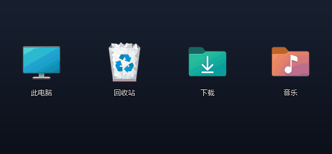
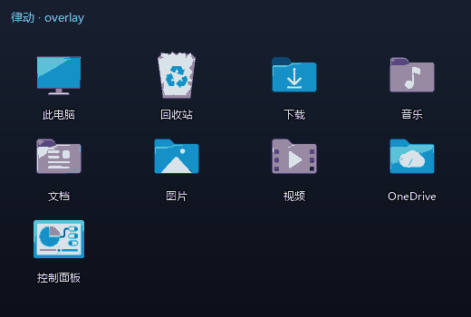
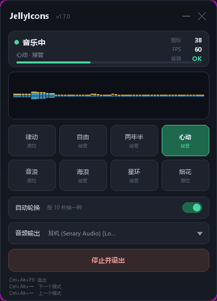
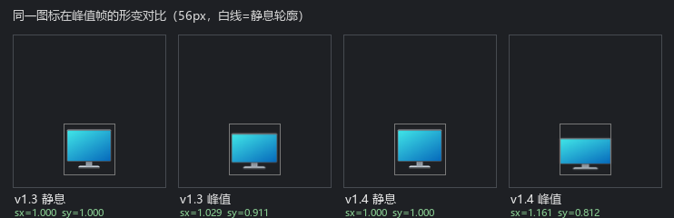

# JellyIcons — Windows 桌面图标随音乐 Q 弹

[](CHANGELOG.md)




*（GIF 由 `docs/make_demo.py` 用真实图标位图 + 真实律动模型离线渲染，
不是录屏；每一帧的形变就是程序实际会做的形变。）*



*（同一份图标，依次走 律动 → 音浪 → 心动 → 海浪 → 星环。注意前两档
图标始终待在自己的格子里——那是 `overlay` 引擎；后三档整体重排，
那是 `takeover` 引擎，移动的是副本窗口，不是桌面上真正的图标。）*

把你 Wallpaper Engine 桌面壁纸的果冻律动，原样搬到桌面图标上：
图标随音乐低频节拍 Q 弹拉伸（横向最大 +16%、纵向最大 -19%、底部中心锚点、果冻落地感），
拖动 / 删除 / 框选 / 右键等一切桌面交互保持系统原生。

**8 种动画模式 + 双引擎**：原位果冻（律动/音浪/烟花）与整版排版
（自由/两年半/心动/海浪/星环）可以随时切换、自动轮换。两档都**一个字节
都不写 explorer 的图标坐标**——位移的是我们自己的分层窗口，随时强杀
都不会打乱桌面布局。

音乐响起来时，真实图标会**自动让位**给会动的副本（连文字标签一起接管），
音乐停止后**自动恢复**——用的是 Windows 自带"显示桌面图标"开关
操作的那个窗口，随时可逆。切换是**无感**的：副本先按 1:1 画满屏幕，
再让真图标消失，中间不会闪出一帧空桌面。

副本显示期间，**双击某个图标即可打开对应应用**（只读轮询实现，
不抢输入、不装钩子）。控制面板（Tk）可以选音频设备、看实时波形、
点模式按钮、开关自动轮换。

> 动力模型逐行移植自工坊壁纸 `431960/3795008547`（Dance Doll 系）的
> `project.json` 实际参数，观感与壁纸本体一致。

<details>
<summary><b>English</b></summary>

**JellyIcons** makes your Windows desktop icons bounce and squash with the
music, the same jelly physics as the Wallpaper Engine wallpaper it was
reverse-engineered from. Dragging, deleting, rubber-band selecting and
right-clicking all keep working exactly as stock Windows.

Each icon gets its own fully click-through layered window
(`WS_EX_TRANSPARENT` + `HTTRANSPARENT`), so every mouse event still lands on
the real icon underneath. Desktop layout is read through UI Automation
(read-only — no cross-process memory writes, no registry writes, no global
hooks). When music starts, the real icons step aside for the animated copies
and come back when the music stops; while they are hidden, double-clicking a
copy launches the app.

</details>

## 为什么这个项目是安全的

上一代原型（DesktopJelly）用跨进程内存读写 + 注册表改写，酿成过桌面
框选失效的事故。JellyIcons 是完全重写的干净架构：

| 事项 | JellyIcons 的做法 |
|---|---|
| 桌面图标数据 | **UI Automation 只读**（句柄链 + ElementFromHandle），零写入 |
| 图标位置 | **零写入**。连"自由/两年半"这类整版排版，移动的也只是我们自己的分层窗口，explorer 的 `IconLayouts` 一个字节都不改 |
| 真图标处理 | 平时**完全不碰**；音乐模式只切换其窗口可见性（等同系统开关） |
| 注册表 | **零写入**（只读 `HideIcons` 判断你是否本来就隐藏了图标） |
| 输入 | **无全局钩子**；overlay 窗口 `WS_EX_TRANSPARENT` + `HTTRANSPARENT` 全穿透 |
| 全局热键 | `RegisterHotKey`（系统匹配、只收消息），**不用 `WH_KEYBOARD_LL`** |
| 双击打开 | 只读轮询 `GetAsyncKeyState`+`GetCursorPos`，不注入、不拦截、不抢焦点 |
| 拖动/删除/框选/右键 | **系统原生**，穿透层不挡任何事件 |
| 退出 | 副本先归位 1:1 → 恢复图标显示 → 删心跳文件；强杀由独立看门狗 1 秒内自愈 |

原理：真桌面图标（SysListView32）之上悬浮每图标一个完全鼠标穿透的
分层窗口，只负责画“会 Q 弹的图标副本”。因为窗口穿透，所有鼠标事件
原样落到真图标上。

### 隐藏真图标前的三道门槛（v1.5.0）

“宁可不动，也不要把桌面弄空”——所以隐藏不是无条件的：

1. **快照有效**：UIA 读到了桌面列表，且读到的图标数 > 0。
2. **覆盖完整**：快照里的每个图标 key 都有对应 overlay 窗口，
   数量与集合完全一致，一个都不许缺。
3. **绘制成功**：每一项的副本都真的画出来了（`ready is True`）。

任一条不满足 → 保留真图标 + 写一条 warning，效果只是“这次没动”，
而不是“桌面空了”。恢复同理：只有 `IsWindowVisible` 确认为真才清心跳，
恢复失败会把 `hidden=True` 心跳留着，让看门狗继续重试。

## 音乐模式怎么工作

| 阶段 | 发生什么 |
|---|---|
| 检测到音乐 | 活动度 `presence ≥ 0.02` 持续 0.15 秒（约 0.2 秒响应） |
| 切换瞬间 | 先把副本按 1:1 画满 → 再隐藏真图标列表窗口（画面零变化） |
| 播放中 | 副本接管：图标本体 + 文字标签一起画，本体照常 Q 弹；双击可打开 |
| 音乐停止 | `presence ≤ 0.008` 持续 1 秒 → 恢复真图标，再延迟 0.12 秒撤副本 |
| 进程被强杀 | 看门狗（独立子进程）发现心跳停止 → 恢复图标显示 |

- 隐藏动作就是 `ShowWindow(SysListView32, SW_HIDE)`，与右键桌面 →
  查看 → 取消"显示桌面图标"操作同一个窗口，逐像素一致、瞬时、可逆。
- 你本来就把图标隐藏了（`HideIcons=1`）时，音乐模式自动禁用，
  不代你做决定。
- 滞回阈值在 `jellyicons/config.py` 顶部可调（`MUSIC_*` 常量）。

### 为什么现在不用等好几秒

Wallpaper Engine 交给壁纸的 `audioData` 是它做过 AGC（自动增益）的
64 段数据，低频常年 0.3~1.0。我们原来除以"全频段最大峰值"，低频被
中高频压住，音乐播放时中位数只有 0.011——要连续 0.75 秒高于 0.03
才能触发隐藏，实际上要等好几秒。

`jellyicons/activity.py` 复刻了那一步 AGC：每个频段各自跟踪峰值、
慢衰减、再归一化；再叠 attack 0.06s / release 0.5s 包络填平节拍间隙。
于是低频稳定落在 0.3~1.0，阈值可以直接卡在"有声音/没声音"的分界上。

### 为什么图标不再左右动

v1.2 的窗口 x 是 `cx - int(side*sx)//2` 算的，`sx` 一变窗口就抖 1~2px；
而隐藏态的合成画布宽度固定，两态基准不同，切换时还会横跳 8px。

现在每个图标一块**固定尺寸画布**：窗口 x/y 只由图标格子矩形和画布尺寸
决定，与缩放完全无关。`test_canvas_independent_of_scale` 锁死这条回归。

## 8 种模式与双引擎

模式分两档，用 `engine` 字段声明，同一套"预绘制→隐藏→归位→恢复"
流程对两档通用：

**`overlay` 原位层** —— 只缩放，**代码级禁止位移**（`Transform.clamp()`
对 overlay 硬把 `dx/dy` 清 0）。图标永远待在自己格子里，不可能跑偏。

| 模式 | 说明 |
|---|---|
| 律动 | 壁纸原版果冻：压扁回弹，底部中心锚点 |
| 音浪 | 64 段频谱分 8 子带，按图标索引均匀绑带，各跳各的 |
| 烟花 | 重拍触发，从屏幕中心向外的涟漪扩散（带距离延迟） |

**`takeover` 接管层** —— 副本可位移、聚拢、绕圈、拼人形。关键区别：
移动的是**我们自己的分层窗口**，不是 `SysListView32` 里的 item。所以
explorer 的 `IconLayouts` 布局数据一个字节都不会被改写，退出时副本
归位 1:1 再把真图标放回来——随时强杀都不打乱桌面。

| 模式 | 说明 |
|---|---|
| 自由 | 随鼓点散开再聚拢，每个图标转速不同 |
| 两年半 | 7 槽位拼小人运球（球有四阶段路径），桌面有腾讯会议图标就拿它当头部，跳满 12 秒一轮才下场 |
| 心动 | 图标沿心形参数方程流动 |
| 海浪 | 波峰错开、起伏沿横向传递 |
| 星环 | 三层同心环，奇偶层反向旋转，按节奏舒展 |

**自动轮换**：每模式停留 `dwell_s`（默认 10 秒）；`两年半` 设
`dwell_s=None`，改为 `wants_exit()` 等一跳跳完。切换时有 0.2 秒形变
过渡，音乐停下时 0.35 秒平滑归位——不留"突跳"。

**一个模式崩了不影响别的**：`tick()` 抛异常只退化成静止，连续 3 次
自动跳到下一个模式。

## 控制面板与热键



面板是**自绘的**无边框窗口：整块界面由 PIL 渲染成一图像素级贴到 Tk
Canvas 上，圆角以外全涂颜色键（`-transparentcolor`）所以屏幕上只剩下
圆角卡片本身，没有系统标题栏、没有 ttk 那套灰控件。拖标题栏可移动，
右上角折叠 / 关闭。

它跑在独立 Tk 线程，所有交互只通过 `app.post()` 发消息、`app.snapshot()`
读快照，绝不跨线程碰窗口或桌面：

- 状态卡：音乐中 / 待机 · 当前模式 · 引擎（原位/接管）· 图标数 · FPS ·
  音频状态 · 底部一条低频电平
- 64 段实时频谱（绿柱 + 黄色峰值保持）
- 8 个模式按钮（当前模式绿框高亮，副标注明是"原位"还是"接管"）
- 自动轮换开关、音频输出设备下拉、停止并退出
- 三行热键提示

热键（`RegisterHotKey`，独立消息线程，**不用全局低级钩子**——钩子会
堵系统输入队列，早期版本真的把鼠标卡死过）：

| 热键 | 作用 |
|---|---|
| `Ctrl+Alt+F9` | 退出 |
| `Ctrl+Alt+→` / `Ctrl+Alt+←` | 下一个 / 上一个模式 |
| `Ctrl+Alt+Space` | 自动轮换开关 |

tkinter 缺失或被占用时，面板和热键都只记一条日志，主功能照常跑。

## 安装

### 方式一：直接用 exe（推荐，换台电脑拷过去就能跑）

1. 从 [Releases](../../releases) 下载 `JellyIcons.exe`
2. 双击。**不需要装 Python，不需要装任何依赖**

单文件、免安装、不带注册表项。日志、心跳、comtypes 代码缓存放 exe 同级
目录（不可写时自动落到 `%LOCALAPPDATA%\JellyIcons`），不污染系统。

### 方式二：从源码跑

1. Windows 10/11
2. `uv venv --python 3.11 .venv`
3. `uv pip install --python .venv/Scripts/python.exe -r requirements.txt`
4. `python make_launchers.py` 生成启动脚本
5. 双击 `启动.bat`

自己打包：`python build_exe.py`（产物在 `dist/JellyIcons.exe`）。

> 装的是 uv 的独立 Python 而不是微软商店版，因为商店版 python.exe 带
> 低完整性标签，会被 UIPI 拦住读不到桌面图标——这就是 v1.5.0 之前
> "双击启动毫无效果"的真正原因。

## 使用

- **启动**：双击 `JellyIcons.exe`（或源码版的 `启动.bat` / `静默启动.vbs`）
- **播放音乐**，图标开始随低频节拍 Q 弹；音乐一响（约 0.2 秒）真图标
  自动隐藏，换成会动的副本，音乐停 1 秒后自动恢复
- **切模式**：控制面板点按钮，或 `Ctrl+Alt+→/←`；自动轮换默认开
- **双击副本图标** = 打开对应应用（音乐模式期间有效）
- **关闭**：`Ctrl+Alt+F9` / 面板"停止并退出" / 控制台 Ctrl+C；
  即使直接强杀，看门狗也会把图标恢复回来
- **只允许开一个**：v1.5.0 起有单实例互斥，第二个实例会直接退出
  （避免两个进程互相覆盖心跳、抢着隐藏/恢复图标）
- **没效果**：`JellyIcons.exe --diagnose`（源码版跑 `诊断.bat`）

## 诊断

`诊断.bat`（或 `python run.py --diagnose`）不动桌面，逐项自检：

1. 进程完整性（须 Medium/High，Low 说明你从沙箱启动的）
2. 音频 loopback（播放音乐 8 秒，bass 峰值应 > 0.02）
3. Shell 图标位图（应取到几十项）
4. UIA 桌面布局（应列出图标名和坐标；失败时附窗口链转储）
5. 副本覆盖率（每一项都有位图吗；不达标就不能安全隐藏真图标）

运行日志在 `JellyIcons.log`（自动轮转，1 MB × 3 备份），主循环每 5 秒
输出 `[stat] overlays/bass/scale/fps/redraw` 健康行。

## 参数定制

`jellyicons/config.py` 里两组旋钮：

**幅度**（v1.4 调过，现在比壁纸原版更明显）

| 常量 | 值 | 含义 |
|---|---|---|
| `AGC_TO_VOL` | 0.10 | AGC 后的低频（0~1）换算成壁纸量级的 rawVol。0.055 时 pulse 只用掉 54% 上限，横向只有 +2.9%；0.10 让 pulse 打到约 68% |
| `JELLY_GAIN_X` | 4.2 | 横向拉伸增益。横向天生不显眼（只变宽），实测需要比 Y 大得多的增益 |
| `JELLY_GAIN_Y` | 1.8 | 纵向压扁增益 |
| `JELLY_MAX_W` | 1.35 | 画布按此预留本体最大横向放大，改大增益必须同步改大，否则会裁边 |

**壁纸原版动力模型**（`DOLL` 字典，与工坊壁纸 `project.json` 一致）

| 参数 | 壁纸值 | 含义 |
|---|---|---|
| `volumeCap` | 0.05 | pulse 上限 |
| `squashX/Y` | 1.5 | X 拉宽 / Y 压扁倍率 |
| `stiffness` | 3.0 | 追随速度（lerp 系数） |
| `damping` | 0.85 | 弹跳衰减 |
| `noiseThreshold` | 0.02 | 静音判定阈值 |

### 为什么桌面版要比壁纸更夸张

壁纸是整张背景在动，桌面图标只有 56px——同样的百分比在图标上几乎
看不出来。实测 v1.3 的峰峰值：横向 2.6px、纵向 5.8px。现在（v1.4）：
横向 4.2px（+8.6% ~ +16.1%）、纵向 6.1px（-8.0% ~ -18.8%）。



（同一图标在峰值帧的形变；灰框是静息轮廓作参照）

另外 bounce 抖动原来用 `(sin(φ)-1)*amp`，恒带一个 `-amp` 的偏置，
等于把整条曲线往下平移半幅、抖动只剩一半能量。改成 `-|sin(φ)|*amp`
只在压缩侧打半波，幅度翻倍且仍然永不越过 1.0（实测 `sy>1` 帧数 = 0）。


## 项目结构

```
run.py                  入口（--diagnose 诊断 / --watchdog 看门狗 / 数字秒限时测试）
JellyIcons.exe          Releases 里下载的单文件版本（本仓库不打进 git）
启动.bat / 诊断.bat      一键启动 / 一键诊断（源码版）
启动（无窗口）.bat       无控制台启动
静默启动.vbs            无控制台启动（VBS 版）
diagnose.py             诊断模式实现（5 项链路检查）
run_tests.py            一键跑全部单测 + 冒烟
build_exe.py            PyInstaller 打包（--onefile，可选 --console）
make_icon.py            生成多尺寸 .ico（纯 PIL）
make_launchers.py       重新生成启动脚本
jellyicons/
  __init__.py            版本号
  paths.py               源码/打包两种运行方式下的资源与数据目录
  config.py              壁纸参数 + 几何/模式常量
  jelly.py               壁纸 processPulse/updateScale 逐行移植
  audio_engine.py        WASAPI loopback → 64 段对数频谱；设备枚举
  desktop_reader.py      UIA 只读布局（句柄链 + UIA 兜底，comtypes 缓存重定向）
  shell_icons.py         Shell API 取 256px 真 alpha 图标位图
  overlay.py             穿透分层窗口（UpdateLayeredWindow）
  activity.py            活动度检测 + 逐频段 AGC（等价壁纸拿到的 audioData）
  music_mode.py          音乐检测滞回 + 图标隐藏/恢复状态机
  click_open.py          双击副本打开对应应用（只读轮询，无钩子）
  single_instance.py     单实例互斥（避免多开互踩心跳）
  watchdog.py            强杀自愈（独立子进程，心跳文件）
  integrity.py           完整性级别自检（Low 会被 UIPI 拦住读桌面）
  hotkey.py              RegisterHotKey 全局热键（不用低级钩子）
  ui.py                  自绘控制面板（PIL 渲染 + Tk 颜色键透明，独立线程）
  modes/
    base.py              Transform / Mode / ModeContext + 引擎常量
    util.py              approach / clamp / lerp / sustain
    switcher.py          自动轮换 + 过渡 + 失败降级
    jelly.py             律动        (overlay)
    bands.py             音浪        (overlay)
    firework.py          烟花        (overlay)
    free.py              自由        (takeover)
    kun.py               两年半      (takeover)
    heart.py             心动        (takeover)
    wave.py              海浪        (takeover)
    ring.py              星环        (takeover)
  app.py                 主循环（固定画布几何、无感切换、DPI 感知、跳帧）
  logutil.py             控制台+文件双路日志（轮转）
tests/
  test_jelly.py          律动模型/配置/几何单测（9 项）
  test_app.py            同步去重/固定画布/跳帧/预绘制/覆盖率门槛（17 项）
  test_activity.py       AGC/包络/presence 单测（11 项）
  test_music_mode.py     滞回时序/allow_exit 闸门/预绘制/隐藏退避/恢复失败（18 项）
  test_audio.py          音频回调过期/流中断/缓冲区清理（5 项）
  test_pidl.py           PIDL 释放/身份映射/重名不猜（5 项）
  test_single_instance.py 互斥体获取/释放（5 项）
  test_modes.py          8 模式有界性/引擎契约/切换器/失败降级（28 项）
  test_hotkey.py         热键绑定表/无钩子守卫/注册往返（10 项）
  test_ui.py             面板布局/命中区/点击语义/渲染产物（14 项）
verify_hide.py          真实 ListView 隐藏/恢复验证（finally 保证恢复）
verify_e2e.py           端到端（真窗口 + 假音乐，量形变摆幅与横移）
smoke_v13.py            端到端冒烟（真窗口 + 假快照 + 假音乐）
CHANGELOG.md            版本历史
LICENSE                 MIT
```

## 测试

```
python -X utf8 run_tests.py
```

共 **122 项单测 + 1 个端到端冒烟**，全部不依赖真实桌面。想验真实
隐藏/恢复，另跑 `python -X utf8 verify_hide.py`（内部 finally 保证恢复）。

（不能 `python -m unittest tests.test_jelly`——venv 里 ultralytics 的
`tests` 包会遮蔽我们的包名，属环境问题非代码问题。）

## 已知限制

- 变形幅度（横向最大 +16%、纵向最大 -19%）比壁纸原版夸张——桌面图标
  只有 56px，按壁纸的 ±8% 几乎看不出来；想更克制把 `JELLY_GAIN_X/Y` 调小
- 透明屏保/独占全屏应用之上无效果（overlay 属普通桌面层）
- 快速拖动图标时 overlay 有 0.25s 跟随延迟（布局重读周期）
- 音乐模式隐藏期间，桌面上暂不响应"框选/右键"等针对真图标的操作
  （真图标窗口被隐藏了）；音乐一停立刻恢复。用键盘/其他方式无影响
- 双击打开只在音乐模式期间生效（正常模式真图标自己处理双击）
- `takeover` 模式的位移是相对图标格子的，图标被拖到屏幕边缘时
  有部分会移出可视区（`Transform.clamp` 只夹缩放，不夹屏幕边界）

## License

MIT — 见 [LICENSE](LICENSE)
